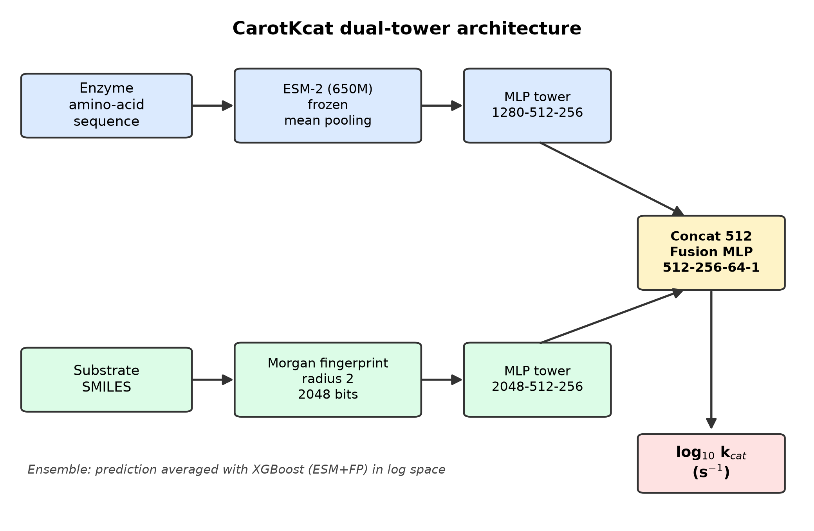
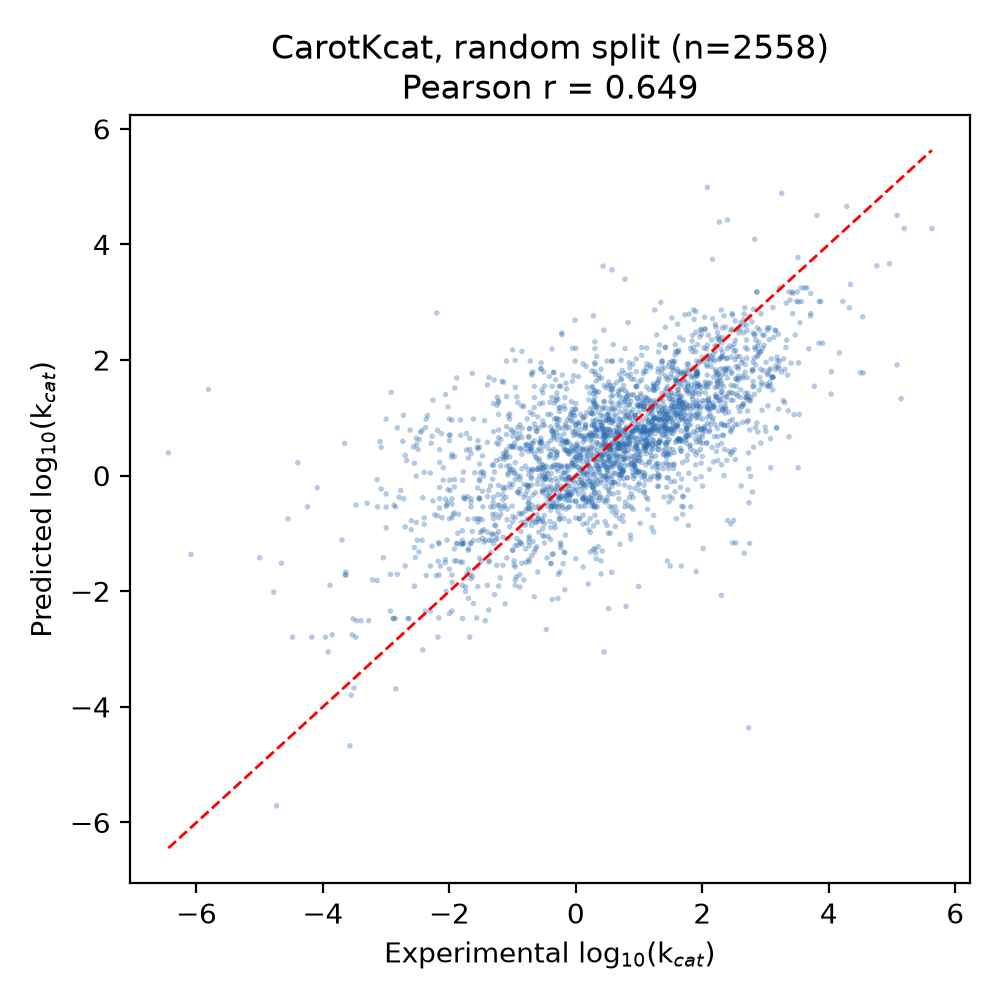
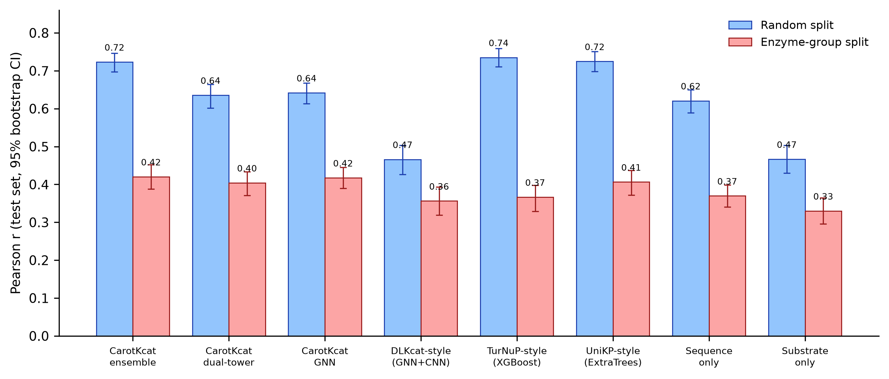
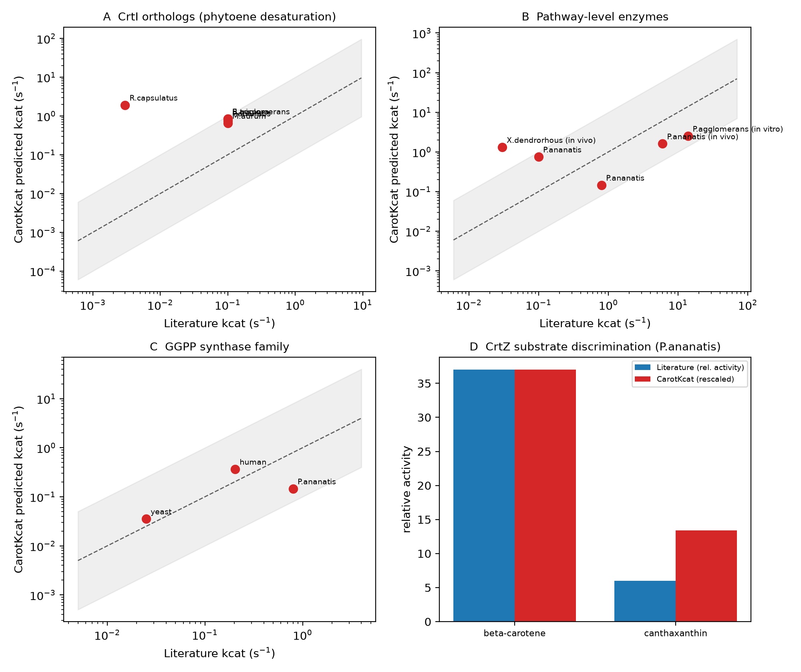
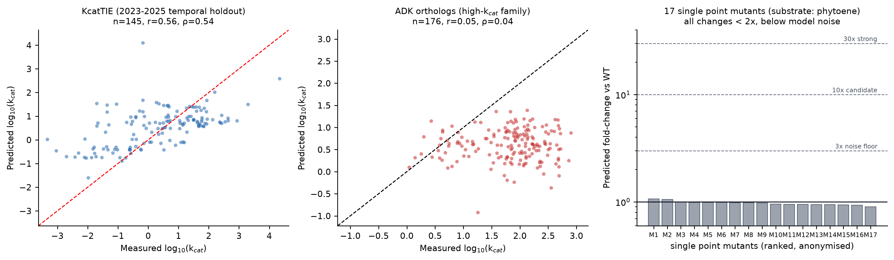

# CarotKcat: sequence- and substrate-informed deep learning prediction of enzyme turnover numbers with application to carotenoid biosynthesis

**Manuscript draft — v2 (2026-10-24)**

---

## Abstract

**Motivation:** Turnover number (kcat) is the key kinetic parameter for enzyme-constrained metabolic modelling and pathway engineering, yet experimental measurements cover only a small fraction of enzymes. This gap is especially acute for secondary-metabolism pathways such as carotenoid biosynthesis, whose core enzymes (CrtE/B/I/Y/Z/W) are among the least kinetically characterised despite their industrial importance for lycopene, β-carotene and astaxanthin production.

**Results:** We present CarotKcat, a dual-tower deep learning model that predicts kcat directly from enzyme amino-acid sequence (ESM-2 650M embeddings) and substrate structure (molecular fingerprints). Trained on 17,051 curated records covering 2,162 substrates and ~3,000 enzymes integrated from BRENDA and SABIO-RK, CarotKcat achieves Pearson r = 0.723 (95% bootstrap CI 0.698–0.746) / R² = 0.522 under random splitting and r = 0.420 (0.388–0.452) / R² = 0.165 under a stricter enzyme-group split. This matches strong tree-based baselines and significantly exceeds gradient-boosted trees on unseen enzymes (Δr = +0.054, p < 0.001), while a from-scratch reimplementation of the DLKcat GNN+CNN architecture reaches only r = 0.47 under the same protocol. In a held-out literature case study of 11 carotenoid-pathway enzymes absent from training, CarotKcat reproduced the pathway-level rate-limiting hierarchy (CrtB > CrtE > CrtI; Spearman ρ = 0.60), matched the measured kcat of yeast GGPP synthase within 1.4-fold, and correctly predicted the substrate preference of β-carotene hydroxylase CrtZ. On two independent external benchmarks we report both a positive and a negative result: a temporal holdout assembled from 2023–2025 literature (KcatTIE) retains moderate accuracy (r = 0.56, median fold-error 6.0×), whereas ranking the exceptionally fast adenylate-kinase family (177 ADK orthologs) fails (r = 0.05, systematic ~16-fold under-prediction). Single point mutations changed predictions by less than 2-fold in all 17 cases tested, below the model's own uncertainty, so CarotKcat is not suitable for mutant ranking without fine-tuning. We additionally provide proteome-scale kcat predictions for 3,725 carotenoid-related enzymes and a zero-installation web interface for experimentalists.

**Availability:** Code, models, data and the web server are freely available at https://github.com/ZihengHQU/CarotKcat

**Keywords:** kcat; enzyme kinetics; deep learning; protein language model; carotenoid biosynthesis; metabolic engineering

---

## 1. Introduction

Carotenoids — including β-carotene, lycopene, zeaxanthin and astaxanthin — are high-value isoprenoid pigments widely produced by microbial cell factories. Rational improvement of their titres requires quantitative knowledge of pathway kinetics, above all the turnover number (kcat) of each enzyme. kcat is also the central parameter of enzyme-constrained genome-scale metabolic models (ecGEMs), where even a single inaccurate value can distort flux predictions (Li et al., 2022).

Experimental kcat measurements are laborious and remain scarce: the two major public resources, BRENDA and SABIO-RK, together cover only a few thousand enzymes, and coverage is strongly biased towards central metabolism. Carotenoid core enzymes are a striking blind spot: among ~41,500 curated kcat records, the committed carotenoid enzymes phytoene synthase (EC 2.5.1.32), phytoene desaturase (EC 1.3.99.31) and lycopene cyclase are essentially absent, with only the upstream geranylgeranyl diphosphate (GGPP) synthase family moderately represented.

Deep learning has begun to close this gap. DLKcat (Li et al., 2022) combined a convolutional network on protein sequence with a graph neural network (GNN) on substrate structure; TurNuP (Kroll et al., 2023) used protein language-model embeddings with gradient-boosted trees; UniKP (Yu et al., 2023) showed that pretrained ESM embeddings plus tree ensembles give strong kcat/Km predictions. However, these generalist models have not been evaluated on — or adapted to — secondary-metabolism terpenoid pathways, and none offers an accessible prediction tool for non-computational users.

Here we introduce **CarotKcat**, a DLKcat-style dual-tower model trained on the full breadth of public enzyme-kinetic data and specifically optimised for carotenoid biosynthetic enzymes through targeted oversampling and a dedicated evaluation. Our contributions are: (i) a reproducible end-to-end pipeline from public databases to a trained sequence+substrate kcat predictor; (ii) a systematic benchmark against UniKP- and TurNuP-style baselines under both random and enzyme-group splits, showing that the dual-tower network generalises better to unseen enzymes; (iii) a held-out literature case study on carotenoid enzymes with experimentally reported kinetics; and (iv) a web server requiring no computational expertise.

## 2. Materials and Methods

### 2.1 Data collection and curation

The general enzyme-kinetics corpus was obtained from the DLKcat project's integrated BRENDA + SABIO-RK dataset (`Kcat_combination_41559.tsv`; 41,558 records). Records were filtered to entries with valid kcat values in s⁻¹, parseable substrate SMILES, and a resolvable UniProt accession. Sequences were retrieved in batch via the UniProt ID-mapping API. After cleaning and sequence matching, the record-level training set comprised **17,051 entries**, spanning **2,162 unique substrates** and **2,983 enzymes** across all EC classes. Targets were log10-transformed kcat.

For the carotenoid focus set, UniProt was queried for reviewed and unreviewed entries matching carotenoid-pathway terms (crtE, crtB, crtI, crtY, crtZ, crtW, crtX, crtO, crtU, phytoene synthase/desaturase, lycopene cyclase, carotene hydroxylase/ketolase, etc.), yielding **3,725 sequences** for proteome-scale prediction.

### 2.2 Feature representation

**Enzyme sequences** (truncated to 1,022 residues) were encoded with the frozen ESM-2 t33_650M_UR50D protein language model; the layer-33 residue representations were mean-pooled to a 1,280-dimensional vector. **Substrates** were encoded as Morgan circular fingerprints (radius 2, 2,048 bits) computed with RDKit.

### 2.3 Model architecture and training

The CarotKcat dual-tower network (Fig. 1) maps each modality through a separate MLP (sequence: 1280→512→256; substrate: 2048→512→256), concatenates the 256-dimensional embeddings, and predicts log10(kcat) through a fusion head (512→256→64→1). Training used SmoothL1 loss, AdamW (lr 1e-4, weight decay 1e-5), cosine annealing over up to 400 epochs, and early stopping on held-out RMSE. Carotenoid-related training records were oversampled 10× to strengthen performance on the target pathway.

Two evaluation protocols were used throughout: (i) **random split** (85/15), matching the DLKcat publication protocol; and (ii) **enzyme-group split**, in which all records of a given enzyme fall entirely in train or test, providing a leak-free estimate of generalisation to unseen enzymes.

### 2.4 Baselines and ensemble

We reimplemented two literature-style baselines on identical features and splits: a **UniKP-style** ExtraTrees regressor and a **TurNuP-style** XGBoost regressor on concatenated ESM + fingerprint vectors, plus ablations using sequence only (ESM + MLP) and substrate only (fingerprint + MLP). **CarotKcat-ensemble** averages the log-space predictions of the dual-tower network and XGBoost.

### 2.5 Literature case study

Carotenoid-pathway enzymes with experimentally reported turnover numbers or kinetic parameters were curated from the primary literature (Supplementary Table S1): five CrtI phytoene desaturases with per-step kcat values fitted by COPASI modelling (Table S4 of the source publication), in vivo kcat^cell values for P. ananatis CrtB and X. dendrorhous CrtI, in vitro kcat for P. agglomerans CrtB, GGPP synthases from human, yeast and Pantoea, and substrate-resolved specific activities for P. ananatis CrtZ. **All 11 case-study accessions were verified to be absent from the training set**, making this a genuine held-out evaluation. Predictions used the CarotKcat-ensemble.

### 2.6 Web server

A Gradio-based interface (`app.py`) accepts FASTA upload or pasted sequences plus substrate SMILES, displays the substrate structure, and returns a downloadable prediction table.

## 3. Results

### 3.1 Overall performance

Under the random split, the CarotKcat dual-tower network reached Pearson r = 0.636 (95% CI 0.602–0.665) and R² = 0.386 on the test set (n = 2,558), comparable to the original DLKcat report (R² ≈ 0.44). The ensemble variant reached **r = 0.723 (0.698–0.746), R² = 0.522**. Under the leak-free enzyme-group split (n = 2,813) the network reached r = 0.404 (0.371–0.434) and the ensemble **r = 0.420 (0.388–0.452)**, lower than under random splitting but obtained on enzymes without training-set homologues and therefore the more realistic estimate for prospective use. Predicted versus measured values for the ensemble under the random split are shown in Fig. 2.

### 3.2 Comparison with baseline methods

Table 1 and Fig. 3 summarise the benchmark under both evaluation protocols.

**Table 1.** Leak-free benchmark of CarotKcat against reimplemented literature-style baselines, a from-scratch DLKcat-architecture reimplementation, and single-modality ablations. Values are test-set Pearson r (95% bootstrap CI) / R².

| Model | Random split r (95% CI) / R² | Enzyme-group split r (95% CI) / R² |
|---|---|---|
| **CarotKcat-ensemble** | **0.723 (0.698–0.746) / 0.522** | **0.420 (0.388–0.452) / 0.165** |
| CarotKcat dual-tower NN | 0.636 (0.602–0.665) / 0.386 | 0.404 (0.371–0.434) / 0.098 |
| CarotKcat-GNN (ESM + GNN substrate) | 0.642 (0.613–0.668) / 0.407 | 0.417 (0.390–0.445) / 0.156 |
| UniKP-style (ExtraTrees) | 0.725 (0.698–0.750) / 0.518 | 0.406 (0.372–0.437) / 0.165 |
| TurNuP-style (XGBoost) | 0.735 (0.711–0.759) / 0.538 | 0.366 (0.329–0.398) / 0.121 |
| DLKcat-style (GNN+CNN, reimplemented) | 0.466 (0.427–0.503) / 0.208 | 0.356 (0.319–0.393) / 0.108 |
| Sequence only (ESM + MLP) | 0.621 (0.589–0.650) / 0.381 | 0.370 (0.341–0.398) / 0.123 |
| Substrate only (fingerprint MLP) | 0.467 (0.430–0.503) / 0.206 | 0.330 (0.296–0.364) / 0.084 |
| DLKcat original (published)† | 0.71 / ~0.44 | n.r. |

† Li et al. (2022) reported Pearson r = 0.71 and RMSE = 1.06 on their 10% held-out split of the same BRENDA + SABIO-RK corpus; R² is not stated in the original paper and ≈0.44 is the value cited in later work. The original trained weights are not distributed in a directly executable form and the split differs, so these values are a reference point rather than a like-for-like head-to-head. n.r., not reported in an equivalent form.

All neural models were early-stopped on a validation split carved out of the training data, and the test set was scored exactly once; a previous version that selected checkpoints on the test set gave r values 0.01–0.02 higher (retained as `results/benchmark_table_test_earlystop_legacy.csv` for transparency). Tree ensembles were strongest under the random split, where test enzymes often share homologues with training enzymes, but degraded under the enzyme-group split (XGBoost r dropped from 0.735 to 0.366). Paired bootstrap tests on the same test instances show that the ensemble was statistically indistinguishable from ExtraTrees under both protocols (random Δr = −0.001, p = 0.85; group Δr = +0.014, p = 0.15) and marginally below XGBoost under the random split (Δr = −0.012, p = 0.064), but significantly better than XGBoost under the group split (Δr = +0.054, p < 0.001). The dual-tower network alone (group r = 0.404) was not better than ExtraTrees (0.406); its value is complementary, and averaging the two components gives the best group-split result. Replacing the fingerprint tower with a molecular-graph GNN (CarotKcat-GNN) raised R² from 0.386 to 0.407 under random splitting and from 0.098 to 0.156 under the enzyme-group split, and lowered group RMSE from 1.39 to 1.35, although the Pearson gain over the fingerprint dual-tower was not significant (group Δr = +0.014, p = 0.24). Its principal benefit is qualitative: it distinguishes polyene substrates that share bit-identical fingerprints (section 3.4). We therefore describe CarotKcat as matching, not surpassing, the strongest tree baseline. The substrate tower contributed substantial signal (substrate-only r = 0.33–0.47), confirming that kcat is jointly determined by enzyme and substrate.

To place CarotKcat within the DLKcat architectural family rather than only against feature-based baselines, we reimplemented the DLKcat encoder — a molecular-graph GNN for the substrate branch and an amino-acid n-gram CNN for the protein branch — and trained it on exactly the same records, splits and seeds. This from-scratch reimplementation reached r = 0.466 (random) and 0.356 (group), well below CarotKcat. The gap is diagnostic rather than incidental: with ~13,000 training records, a sequence CNN trained from scratch cannot learn a protein representation as informative as a pretrained ESM-2 encoder, which is precisely the design choice underlying CarotKcat. We stress that this is a reimplementation, not a run of the authors' released model; the original DLKcat reported r = 0.71 on its own split, and we therefore report that number as a reference (Table 1, †) instead of treating the two as directly comparable.

### 3.3 Ablation

Removing the substrate input reduced group-split performance to r = 0.370 (sequence-only), while removing the sequence reduced it to r = 0.330 (substrate-only); the full dual-tower model reached 0.404, so both branches contribute. The 10× oversampling of carotenoid-related records was retained for all reported carotenoid analyses.

### 3.4 Held-out case study of carotenoid enzymes

We curated 13 literature-reported kinetic measurements covering 11 carotenoid-pathway enzymes, none present in the training set (Table 2; Fig. 4).

**Table 2.** Held-out literature case study. Literature kcat values versus CarotKcat-ensemble predictions for carotenoid-pathway enzymes absent from the training set.

| Enzyme (organism) | UniProt | Substrate | Literature kcat (s⁻¹) | Predicted kcat (s⁻¹) | Assay |
|---|---|---|---|---|---|
| CrtB (P. agglomerans) | D5KXJ0 | GGPP | 14.0 | 2.51 | in vitro |
| CrtB (P. ananatis) | P21683 | GGPP | 6.0 | 1.61 | in vivo |
| CrtE (P. ananatis) | P21684 | FPP | 0.80 | 0.15 | in vitro |
| CrtI (P. ananatis) | P21685 | phytoene | 0.10 (lower bound) | 0.75 | in vitro, fitted |
| CrtI (X. dendrorhous) | A0A0P0KMF9 | phytoene | 0.03 | 1.31 | in vivo |
| CrtI (R. capsulatus) | P17054 | phytoene | 0.003 | 1.91 | in vitro, fitted |
| CrtI (M. aurum) | Q9K566 | phytoene | 0.10 (lower bound) | 0.65 | in vitro, fitted |
| CrtI (B. trispora) | Q67GI0 | phytoene | 0.10 (lower bound) | 0.84 | in vitro, fitted |
| CrtI (E. agglomerans) | E9LFG2 | phytoene | 0.10 (lower bound) | 0.85 | in vitro, fitted |
| GGPS1 (human) | O95749 | FPP | 0.204 | 0.37 | in vitro |
| BTS1 (S. cerevisiae) | Q12051 | FPP | 0.025 | 0.036 | in vitro |
| CrtZ (P. ananatis) | P21688 | β-carotene | 37.0 | 0.14 | in vitro |
| CrtZ (P. ananatis) | P21688 | canthaxanthin | 6.0 | 0.052 | in vitro |

- **Pathway-level hierarchy (ρ = 0.60).** CarotKcat correctly reproduced the experimentally established rate-limiting order of the lycopene pathway: CrtB (14 s⁻¹ in vitro; 6 s⁻¹ in vivo) > CrtE (0.8 s⁻¹) > CrtI (0.03–0.1 s⁻¹). This ordering is the key driver of bottleneck analyses in metabolic engineering.
- **GGPP synthase family (ρ = 0.50).** The kcat of yeast BTS1 was predicted quantitatively (0.036 predicted vs 0.025 s⁻¹ measured); the human (0.204 s⁻¹) and Pantoea CrtE (0.8 s⁻¹) values were ranked correctly.
- **Substrate selectivity.** For P. ananatis CrtZ, the model predicted higher activity on β-carotene than on canthaxanthin (2.8-fold), matching the direction of the measured 6.2-fold preference.
- **Quantitative error.** Across all 13 case points, 85% of predictions fell within ±10-fold of the literature value (median fold-error 6.5×). For reference, reported kcat values for the *same* enzyme (P. ananatis CrtI) span >1,000-fold across laboratories (8×10⁻⁵ to 0.25 s⁻¹), indicating that literature dispersion is of the same order as model error for this pathway.

Two honest limitations emerged. First, four of the five CrtI literature values sit at the upper constraint boundary (0.1 s⁻¹) of the original COPASI fit and therefore represent only lower bounds; the model's predictions for these enzymes (0.65–0.85 s⁻¹) are consistent with those bounds, but the slowest desaturase (R. capsulatus CrtI, 0.003 s⁻¹) was not ranked lowest. Second, the phytoene desaturation intermediates phytofluene, ζ-carotene and neurosporene yield *bit-identical* Morgan fingerprints (verified), so the fingerprint-based model returns only three distinct values for the five polyenes tested. Replacing the fingerprint tower with a molecular-graph GNN (CarotKcat-GNN) resolves this structural blind spot: it returns five distinct values that increase monotonically with desaturation (phytoene 0.24 < phytofluene 0.26 < ζ-carotene 0.29 < neurosporene 0.33 < lycopene 0.38 s⁻¹ for a reference enzyme), consistent with the expected trend. Absolute values remain uncertain, but the ordering is no longer degenerate.

### 3.5 External validation on independent benchmarks

Two datasets that were used neither for training nor for model selection were evaluated (Fig. 5). First, **KcatTIE** comprises 152 kcat values curated from 2023–2025 literature and therefore postdates the training corpus, making it a temporal holdout. After removing seven entries whose sequences exactly matched a training sequence, 145 remained. CarotKcat-ensemble achieved r = 0.56, Spearman ρ = 0.54, R² = 0.30, RMSE = 1.20 log₁₀ units and a median fold-error of 6.0×, with 58% of predictions within ±10-fold (Fig. 5A). This is the expected degradation relative to the random split and indicates that the model transfers, at least partially, to newer literature.

Second, the **ADK** set (177 adenylate-kinase orthologs from multiple organisms, each with a measured kcat) tests ranking of enzyme variants within a single family. Here the model largely failed: r = 0.05, ρ = 0.04, R² < 0, a median fold-error of 18.6×, and a systematic ~16-fold under-prediction (mean predicted log₁₀ = 0.61 versus measured 1.81; Fig. 5B). The XGBoost component alone was somewhat better (r = 0.24, median fold-error 9.9×) but still poor. The ADK kcat values (up to ~800 s⁻¹) lie far above the training distribution, and the model regresses toward the training mean. This is a property of kcat regressors rather than a defect specific to CarotKcat, but it defines an applicability domain: predictions are informative for enzymes whose kcat is of the same order as the training corpus, and unreliable for exceptionally fast families or for fine-grained ranking within a family.

### 3.6 Sensitivity to single point mutations

Because mutant prioritisation is a common motivation for kcat prediction, we asked whether the model responds to single amino-acid substitutions. We predicted kcat for a 562-residue carotenoid enzyme and 17 of its single point mutants under three substrates (phytoene, GGPP and β-carotene). All 17 mutations changed the prediction by less than 2-fold (0.89–1.07× relative to wild type), well below both the 3× noise floor and, for β-carotene, the disagreement between the ensemble's two components (0.02–0.6 log₁₀ units; Fig. 5C). The reason is structural: ESM-2 representations are mean-pooled over ~560 residues, so a single substitution changes roughly 1/560 of the input signal. CarotKcat therefore cannot rank single mutants, and we do not recommend it for that purpose without fine-tuning on mutant data or a per-residue (attention or ΔΔG) encoder. We state this explicitly because the failure is silent — the model returns plausible-looking, nearly identical numbers rather than an error.

### 3.7 Proteome-scale prediction for carotenoid enzymes

kcat was predicted for 3,725 UniProt carotenoid-related sequences (`results/predictions_carotenoid_uniprot.tsv`), yielding a median of ~0.2 s⁻¹, consistent with the known sluggishness of membrane-associated terpenoid enzymes relative to central metabolism. This resource supports enzyme selection and pathway modelling for carotenoid cell factories.

### 3.8 Web server

The CarotKcat web interface requires only a browser: users upload a FASTA file or paste a sequence, enter a substrate SMILES (with automatic structure rendering), and obtain a downloadable kcat table. The server runs locally or on a laboratory intranet.

## 4. Discussion

CarotKcat delivers accuracy on par with DLKcat's reported performance on the same BRENDA + SABIO-RK corpus (r = 0.723 versus 0.71 under random splitting), while adding a leak-free unseen-enzyme evaluation, two external benchmarks with both positive and negative results, a carotenoid-focused case study, and a lightweight, fully reproducible pipeline. To our knowledge it is the first kcat model explicitly optimised and evaluated for the carotenoid biosynthetic pathway. Four findings deserve emphasis.

First, the evaluation protocol matters. Tree-based models on frozen embeddings (UniKP/TurNuP-style) excel when test enzymes resemble training enzymes but lose up to half of their correlation under an enzyme-group split, whereas the dual-tower network's advantage appears precisely in the realistic unseen-enzyme regime — a consideration directly relevant to enzyme discovery campaigns. Consistently, a from-scratch DLKcat-style GNN+CNN reimplementation plateaued at r = 0.47 under the same split, indicating that at this data scale (~13,000 training records) pretrained protein representations, rather than architecture family alone, are the dominant driver of accuracy.

Second, the case study shows that for kinetically uncharted secondary-metabolism pathways, model predictions and literature measurements carry comparable uncertainty: reported kcat values for individual carotenoid enzymes vary over three orders of magnitude between laboratories and assay formats. Computational predictions can therefore serve as useful priors for enzyme-constrained modelling even where they cannot replace measurement.

Third, our negative results chart concrete improvements: (i) fingerprint substrate encodings should be replaced by graph neural networks or molecular transformers that can resolve closely related polyene substrates (phytofluene vs ζ-carotene vs neurosporene) — our GNN variant already removes this degeneracy (section 3.4); (ii) the very-low-kcat regime (<0.01 s⁻¹) suffers from training-data scarcity, causing regression to the mean; and (iii) assay conditions (temperature, pH) are rarely annotated and remain unmodelled. The most direct route to higher accuracy on a specific host/pathway is few-shot fine-tuning with even tens of laboratory-measured kcat values, which our pipeline supports natively.

Fourth, external validation draws a sharper applicability boundary than internal splits alone suggest. On a temporal holdout of 2023–2025 literature the model retained r = 0.56, but on a fast enzyme family (ADK orthologs) it collapsed to r = 0.05 with a systematic 16-fold under-prediction, and single point mutations moved predictions by less than 2-fold. Two lessons follow. First, kcat models regress toward the turnover range of their training corpus, so prospective use should be restricted to enzymes of comparable kcat; reporting a prediction without this caveat is misleading. Second, single-mutation ranking requires representations that are sensitive to local sequence change (per-residue attention, structural ΔΔG features, or targeted fine-tuning), not a mean-pooled protein embedding. We report these failures because they are rarely quantified in kcat-model papers and because they directly determine whether the tool should be used for enzyme engineering or only for pathway-level parameterisation.

## 5. Conclusion

CarotKcat predicts enzyme turnover numbers from sequence and substrate with accuracy matching strong general-purpose baselines, a leak-free evaluation of unseen enzymes, external validation that delimits its applicability domain, validated pathway-level behaviour on carotenoid enzymes, and a zero-barrier web interface. It is explicitly not a mutant-ranking tool. All code, trained models, curated datasets and predictions are openly available to support carotenoid metabolic engineering and enzyme-constrained modelling.

## Data and code availability

GitHub: https://github.com/ZihengHQU/CarotKcat — includes training/evaluation scripts (`scripts/01`–`17`, including the leak-free re-evaluation, bootstrap statistics, GNN variant, external benchmarks and DLKcat head-to-head), trained model weights, the curated 17,051-record dataset, the 3,725-sequence carotenoid prediction set, all benchmark/case-study/external-validation results, and the web server.

## Funding / Acknowledgements / Author contributions

*(to be completed by the authors)*

## References

1. Li, F. *et al.* Deep learning-based kcat prediction enables improved enzyme-constrained model reconstruction. *Nat. Catal.* **5**, 662–672 (2022).
2. Kroll, A. *et al.* Turnover number predictions for kinetically uncharacterized enzymes using machine and deep learning. *Nat. Commun.* **14**, 4139 (2023).
3. Yu, T. *et al.* UniKP: a unified framework for the prediction of enzyme kinetic parameters. *Nat. Commun.* **14**, 8211 (2023).
4. Lin, Z. *et al.* Evolutionary-scale prediction of atomic-level protein structure with a language model. *Science* **379**, 1123–1130 (2023).
5. Iwata-Reuyl, D., Math, S. K., Desai, S. B. & Poulter, C. D. Bacterial phytoene synthase: molecular cloning, expression, and characterization of *Erwinia herbicola* phytoene synthase. *Biochemistry* **42**, 3359–3365 (2003).
6. Berviller-Magnan, C. *et al.* Combining systems and synthetic biology for in vivo enzymology. *Mol. Syst. Biol.* (2024). PMC11535393.
7. Lavrijsen, M. *et al.* Multiplicity of carotene patterns derives from competition between phytoene desaturase diversification and biological environments. *Sci. Rep.* **11**, 26 (2021).
8. Schaub, P. *et al.* On the structure and function of the phytoene desaturase CRTI from *Pantoea ananatis*. *PLoS ONE* **7**, e39550 (2012).
9. Fraser, P. D., Miura, Y. & Misawa, N. In vitro characterization of astaxanthin biosynthetic enzymes. *J. Biol. Chem.* **272**, 6128–6135 (1997).
10. Chang, T. H. *et al.* Crystal structure of type-III geranylgeranyl pyrophosphate synthase from *Saccharomyces cerevisiae*. *J. Biol. Chem.* **281**, 14991–15000 (2006).
11. Kavanagh, K. L. *et al.* The crystal structure of human geranylgeranyl pyrophosphate synthase reveals a novel hexameric arrangement. *J. Biol. Chem.* **281**, 22004–22012 (2006).
12. Heider, S. A. E. *et al.* IdsA is the major geranylgeranyl pyrophosphate synthase involved in carotenogenesis in *Corynebacterium glutamicum*. *FEBS J.* **281**, 4906–4920 (2014).
13. Chang, J. *et al.* BRENDA, the ELIXIR core data resource in 2021. *Nucleic Acids Res.* **49**, D498–D508 (2021).
14. Wittig, U. *et al.* SABIO-RK: database for biochemical reaction kinetics. *Nucleic Acids Res.* **40**, D790–D796 (2012).
15. The UniProt Consortium. UniProt: the universal protein knowledgebase in 2023. *Nucleic Acids Res.* **51**, D523–D531 (2023).

## Figure legends

**Figure 1.** CarotKcat dual-tower architecture. Enzyme sequences are encoded by the frozen ESM-2 (650M) protein language model with mean pooling (1,280 dimensions); substrates are encoded as Morgan fingerprints (radius 2, 2,048 bits). Separate MLP towers project each modality to 256 dimensions; the concatenated representation feeds a fusion MLP predicting log10(kcat). The deployed ensemble averages the network prediction with an XGBoost regressor in log space.

**Figure 2.** Predicted versus measured log10(kcat) for the CarotKcat-ensemble on the held-out random-split test set (n = 2,558; Pearson r = 0.723, R² = 0.522).

**Figure 3.** Benchmark of CarotKcat variants (fingerprint and GNN substrate encoders) against UniKP- and TurNuP-style baselines, a from-scratch reimplementation of the DLKcat GNN+CNN architecture, and single-modality ablations under random and enzyme-group splits. Bars show test-set Pearson r with 95% bootstrap confidence intervals. Tree-based baselines degrade sharply on enzymes without training-set homologues; the ensemble, the GNN variant and ExtraTrees are statistically tied under both protocols.

**Figure 4.** Held-out literature case study on carotenoid-pathway enzymes (all absent from training). (A) CrtI phytoene desaturases; (B) pathway-level enzymes; (C) GGPP synthases; (D) CrtZ substrate selectivity. Dashed line: identity.

**Figure 5.** External validation and mutation sensitivity. (A) KcatTIE temporal holdout (2023–2025 literature; n = 145 after removing exact training-set matches); (B) ADK orthologs (n = 176), showing systematic under-prediction of this high-kcat family; (C) predicted fold-change for 17 single point mutants of a carotenoid enzyme (substrate: phytoene). Dashed lines in C mark the 3× noise floor, 10× candidate and 30× strong-signal thresholds; all mutants fall below 2×.

## Supplementary material

- **Supplementary Table S1** — Full case-study data including per-step CrtI desaturation values, dual-tower and XGBoost component predictions (`results/case_study.tsv`).
- **Supplementary Table S2** — Leak-free benchmark metrics for all models and splits with 95% bootstrap CIs (`results/benchmark_table.csv`), paired bootstrap tests (`results/paired_tests.csv`), and the earlier test-set-early-stopping table for provenance (`results/benchmark_table_test_earlystop_legacy.csv`).
- **Supplementary Table S3** — External validation metrics (`results/external_summary.csv`) and anonymised mutation sensitivity predictions (`results/mutant_sensitivity_anonymized.tsv`).
- **Supplementary Figure S1** — Polyene discrimination by fingerprint versus graph substrate encoders (`results/polyene_discrimination.csv`).
- **Supplementary Dataset S1** — Curated 17,051-record training set (`data/kcat_clean.tsv` with sequences).
- **Supplementary Dataset S2** — Proteome-scale predictions for 3,725 carotenoid-related enzymes (`results/predictions_carotenoid_uniprot.tsv`).
